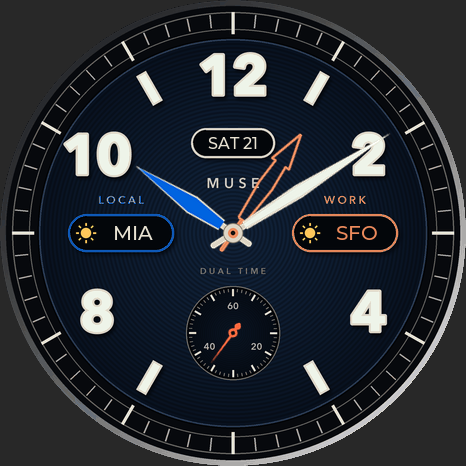
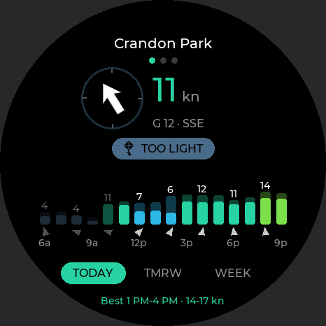
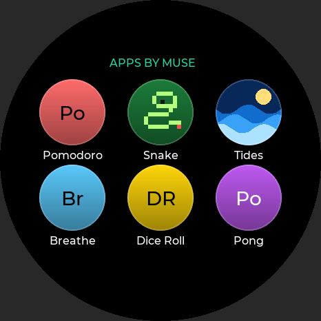

# muse-charm-apps

Firmware and apps for the **Muse Charm**: a Waveshare ESP32-S3-Touch-AMOLED-1.75C
(a round 466x466 touch screen with a microphone and speaker) running Muse, Meta's
personal AI agent, through the open-source
[Muse Gadget SDK](https://github.com/facebookincubator/muse-gadget-sdk).

The board is a thin client: Muse runs in the cloud. You call it with a tap, send
voice notes with a hold, and it shows your Muse's own avatar. This repository
adds apps beside Muse on the same screen, so swiping sideways moves between them.

```
  Wind  |  Stocks  |  Watch  |  Muse  |  Apps  |  Settings
  <---- native apps (C/LVGL) ----     Lua apps by Muse
```

## What we built

**Three native apps**, compiled into the firmware. Muse controls each of them
with its own commands:

| | |
|---|---|
| **Watch** | A dual-time pocket watch. The main hands show *local* time (where you are) and a copper skeleton hand shows *work* time. Muse moves the local zone when you travel (`watch.set_zone`, `watch.swap`, `watch.get`). |
| **Stocks** | META, SHOP and SPY: price, change, and a chart over 1D, 1W, 1M, 1Y or 5Y, from Yahoo Finance's keyless chart API (`stocks.show`, `stocks.get`). |
| **Wind** | A kite forecast in knots: now, today, tomorrow and the week, with the best session window. It covers two home spots plus any place Muse sets (`wind.set_spot`, `wind.show`, `wind.get`). |

**An app launcher for Lua apps.** Muse writes an app in Lua and installs it over
its link to the board with `luapp.install`. The board compiles, saves and opens
it at once, with no firmware build and no flashing. Apps get widgets,
touch, timers, HTTP and JSON, per-app storage, PNG and JPEG images, pixel-art
sprites, a drawing canvas for games, and a 4-channel synth. Up to 9 apps, 64 KB
of source each, run one at a time in a sandbox on their own task.

**Apps by Muse.** [`apps/`](apps/) holds the Lua apps Muse built this way:
Timer, Paddle Ball, Moon Phase, Horoscope, Converter, F1 and Weather.

**Your own avatar, or the default one.** The board can show the SDK's default
character, or your Muse's real avatar animation made from the clips Muse
exports ([docs/avatar.md](docs/avatar.md)).

| Watch | Stocks | Wind | Launcher |
|---|---|---|---|
|  |  |  |  |

## Quick start

You need the board, a USB-C cable, a Mac (the scripts are written for macOS), the
Muse app on your phone with Developer mode on, and an
[SDK token](https://gadgets.muse.ai/settings/sdk-tokens).

```sh
git clone https://github.com/dayvson/muse-charm-apps.git muse-charm && cd muse-charm
scripts/00_setup.sh                 # SDK + patches, ESP-IDF v6.0.3, Python tools (all inside this folder)
scripts/01_backup_factory.sh        # full backup of the factory firmware: do this first
scripts/05_avatar.sh default        # or make your own avatar: docs/avatar.md
scripts/02_build.sh                 # build the firmware
scripts/04_flash_muse.sh            # first time: erase and flash
scripts/03_set_token.sh             # store your SDK token on the board, then pair in the Muse app
```

Then teach Muse to write apps: send it [`muse-prompts/lua-apps.md`](muse-prompts/lua-apps.md)
once, and ask for an app.

**The full walkthrough is in [docs/setup.md](docs/setup.md).** Read it before
flashing.

## Documentation

| | |
|---|---|
| [docs/setup.md](docs/setup.md) | Setting up the ESP32-S3, step by step, with troubleshooting |
| [docs/native-apps.md](docs/native-apps.md) | Watch, Stocks and Wind: what they show, Muse's commands, data sources, how to customise |
| [docs/launcher.md](docs/launcher.md) | The Lua app launcher: how Muse writes, installs and manages apps without a firmware update |
| [docs/avatar.md](docs/avatar.md) | The default avatar, or your Muse's own avatar from its clips |
| [docs/memory.md](docs/memory.md) | Engineering notes: the board's memory limits, and why the patches and settings exist |
| [apps/](apps/) | The Lua apps Muse built, one folder each |

## Repository layout

```
apps/<name>/         Lua apps built by Muse (source and a README each)
firmware/            the native apps, the launcher and the Lua runtime (linked into the SDK
                     as components/muse/apps); Lua 5.4.7 in firmware/lua (unmodified, MIT)
  tests/ tools/      host tests; asset generators and preview renderers
  preview/           rendered previews of the native apps
config/              build settings overlay, partition table, the device guide Muse reads
patches/             changes to the SDK (applied by scripts/00_setup.sh)
scripts/             setup, build, flash, token, avatar, logs
gif-avatar/          the clip-to-avatar converter and the prompts that ask Muse for clips
muse-prompts/        instructions we give Muse (how to write Lua apps)
```

These are created locally and never committed: `muse-gadget-sdk/`, `toolchain/`,
`backups/`, `logs/`, `avatars/` and `avatar-clips/`.

## Status and caveats

This is a hobby project on community hardware. As the SDK puts it, tinkering may
brick boards or void warranties, so proceed at your own risk. It's built and
tested on one board, against SDK commit `b11908c` and ESP-IDF v6.0.3. The Watch,
Stocks and Wind defaults (Miami, San Francisco, Key Biscayne kite spots, the
three tickers) are ours; [docs/native-apps.md](docs/native-apps.md) says where
to change them.
