# muse-charm-apps

Firmware and apps for the **Muse Charm**: a Waveshare ESP32-S3-Touch-AMOLED-1.75C
(a round 466x466 touch screen with a microphone and speaker) running Muse, Meta's
personal AI agent, through the open-source
[Muse Gadget SDK](https://github.com/facebookincubator/muse-gadget-sdk).

The board is a thin client: Muse runs in the cloud. You call it with a tap, send
voice notes with a hold, and it shows your Muse's own avatar. This repository
adds apps beside Muse on the same screen, so swiping sideways moves between them.

```
  Wind  |  Stocks  |  Watch  |  Reply  |  Muse  |  Apps  |  Settings
  <---- native apps (C/LVGL) ---- (SDK)            Lua apps by Muse
```

Reply is the SDK's own page: swipe right from Muse to reread its latest answer.

## What we built

**Three native apps**, compiled into the firmware. Muse controls each of them
with its own commands:

| | |
|---|---|
| **Watch** | A dual-time pocket watch. The main hands show *local* time (where you are) and a copper skeleton hand shows *work* time. Muse moves the local zone when you travel (`watch.set_zone`, `watch.swap`, `watch.get`). |
| **Stocks** | META, SHOP and SPY: price, change, and a chart over 1D, 1W, 1M, 1Y or 5Y, from Yahoo Finance's keyless chart API (`stocks.show`, `stocks.get`). |
| **Wind** | A kite forecast in knots: now, today, tomorrow and the week, with the best session window. It covers two home spots plus any place Muse sets (`wind.set_spot`, `wind.show`, `wind.get`). |

| Watch | Stocks | Wind | The launcher |
|---|---|---|---|
|  | 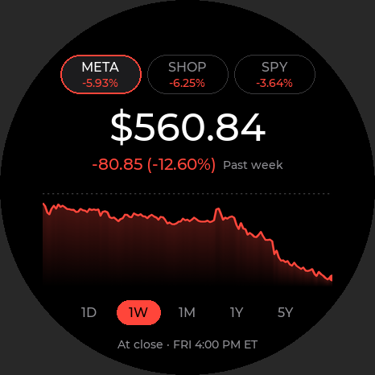 |  |  |

**An app launcher for Lua apps.** Muse writes an app in Lua and installs it over
its link to the board with `luapp.install`. The board compiles, saves and opens
it at once, with no firmware build and no flashing. Apps get widgets (rollers,
sliders, switches, lists, scrolling areas), animation, touch and swipes, timers,
HTTP and JSON, per-app storage and files, PNG and JPEG images, pixel-art sprites,
a drawing canvas for games (timers down to 16 ms, and frames that send the
screen only what changed), a 4-channel synth, the battery, the
microphone level and the motion sensor, alarms that wake the board, and
`muse.ask` to put a question to Muse from inside an app. Muse can take a
screenshot of what its app draws, and measure its speed. Apps run one at a time
in a sandbox on their own task, with up to 64 KB of source each.

**Room for 64 apps.** Apps live on their own 8 MB flash partition, in a folder
rather than FAT's small root directory, and the launcher shows them six to a
page. Only the icons of the page you're on and the next stay in memory
(27 KB each); the rest load from flash as you swipe, so 64 apps cost no more
memory than 9 did. Boards that had apps on the old 1 MB partition get them
copied over, with their files, saved state and alarms, on the first boot, and
the old partition stays as a backup ([docs/launcher.md](docs/launcher.md)).

**Apps by Muse.** These Lua apps were written by Muse and deployed to the board
through the launcher, with no firmware change. Each folder in [`apps/`](apps/) has
the source and a README:

| | |
|---|---|
| [**Timer**](apps/timer/) | A countdown timer with plus and minus buttons and a ring around the rim that is eaten away as time passes, turning from green to yellow to red, with an alarm tune at zero. |
| [**Paddle Ball**](apps/paddle/) | An original brick-breaking game on a canvas: drag to move the paddle, tap to launch, clear 35 bricks, with sound effects and a stored best score. |
| [**Moon Phase**](apps/moon/) | Today's moon drawn on a canvas: the phase computed from the date, with the phase name, percent lit, moon age and the next full or new moon. |
| [**Horoscope**](apps/horoscope/) | A zodiac wheel for the round screen: swipe and the wheel turns your sign to the top, with a medallion and the day's message in the middle. |
| [**Converter**](apps/fx/) | USD, BRL, EUR, GBP and RUB with either side switchable, a keypad for the amount, and live rates from free keyless sources, cached for offline use. |
| [**F1**](apps/f1/) | Formula 1: the next race with a car lapping a drawn circuit and a countdown ring at the edge, the weekend schedule, the last podium and the championship top 3. |
| [**Weather**](apps/weather/) | A living sky for Miami, New York, Rio de Janeiro or San Francisco: an animated sun, moon, stars, clouds, rain or snow, a big temperature and the next three hours, from Open-Meteo. |
| [**Lab**](apps/lab/) | A test bench for the new firmware APIs: a roller page picker, device.info with a live mic bar, motion.read values, a muse.ask button and a 1-minute alarm test. |
| [**Spotify**](apps/spotify/) | A Spotify remote in Spotify's own colours: the playing track with its album art, a progress bar with the current time and duration, Previous / Play-Pause / Next controls, and a Release Radar discovery screen. The controls are optimistic and the transport prefers a small bridge service when one is configured. |
| [**Invaders**](apps/invaders/) | The classic fixed shooter: a marching formation of invaders that drops as it crosses, a cannon steered by dragging, tap or hold to fire, three lives and faster waves, with a stored best score. |
| [**Asteroids**](apps/asteroids/) | The classic vector shooter in pure contours: an outline ship steered by holding a finger down, and four sizes of tumbling outline asteroids that split into two of the next size down when shot. |
| [**Flappy Vela**](apps/flappy/) | The one-button arcade classic with Vela the puppy in the bird's place, propeller hat spinning as she climbs: tap to flap, thread the pipes, one point per pipe, with a stored best score. |
| [**Vela Jump**](apps/doodle/) | A doodle-jump climber: Vela bounces up an endless stack of platforms, drag to steer and wrap around the edges, green platforms steady, blue ones sliding, brown ones breaking, springs for a real launch, and the height in metres as the score. |

| Timer | Paddle Ball | Moon Phase | Horoscope |
|---|---|---|---|
| 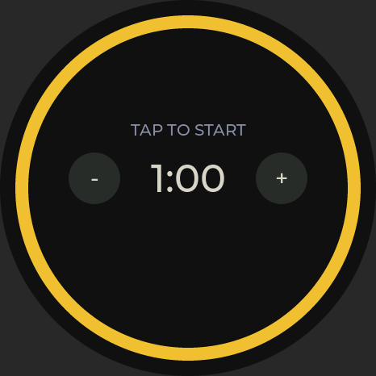 | 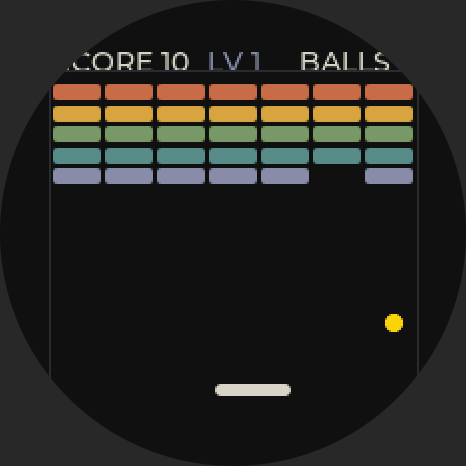 | 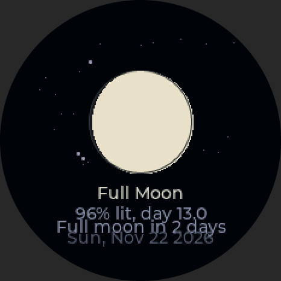 | 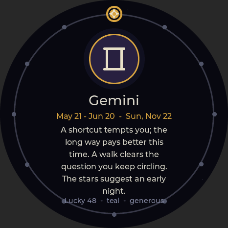 |
| **Converter** | **F1** | **Weather** | **The launcher** |
| 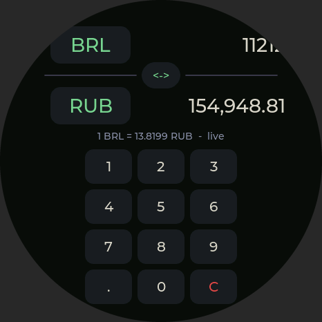 | 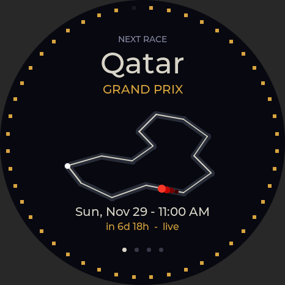 | 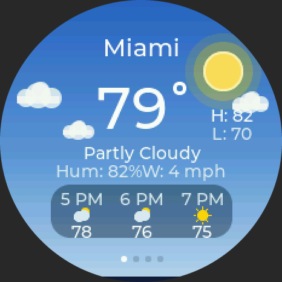 | 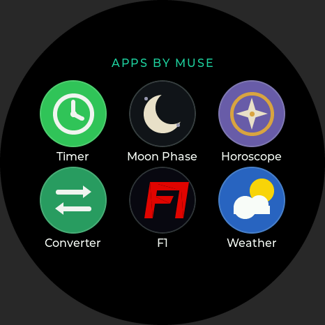 |

<sub>Screenshots taken on the board with `scripts/07_screenshots.sh`.</sub>

**Your own avatar, or the default one.** The board can show the SDK's default
character, or your Muse's real avatar animation made from the clips Muse
exports ([docs/avatar.md](docs/avatar.md)). One command switches between them.

| Default avatar | Your own: Vela, made from its clips |
|---|---|
| 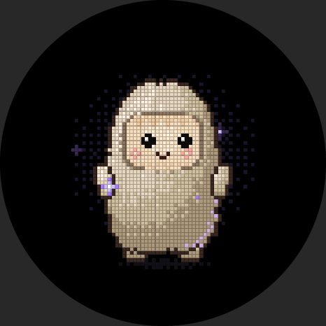 | 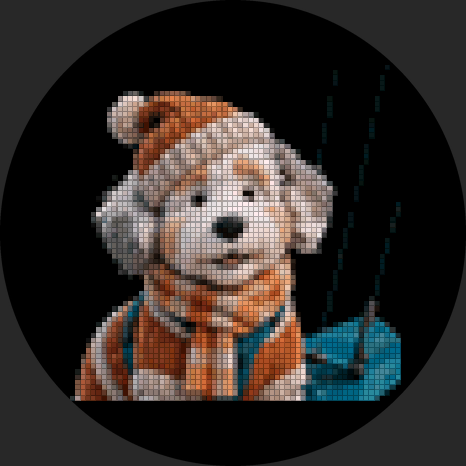 |

<sub>Both are rendered on the Mac with the firmware's own avatar renderer (`tools/muse/make_gifs.py`), showing an idle frame.</sub>

## Quick start

You need the board, a USB-C cable, a Mac (the scripts are written for macOS), the
Muse app on your phone with Developer mode on, and an
[SDK token](https://gadgets.muse.ai/settings/sdk-tokens).

```sh
git clone https://github.com/dayvson/muse-charm-apps.git muse-charm && cd muse-charm
scripts/00_setup.sh                 # SDK + patches, ESP-IDF v6.0.3, Python tools (all inside this folder)
scripts/01_backup_factory.sh        # full backup of the factory firmware: do this first
scripts/05_avatar.sh default        # or make your own avatar: docs/avatar.md
scripts/02_build.sh                 # build the firmware
scripts/04_flash_muse.sh            # first time: erase and flash
scripts/03_set_token.sh             # store your SDK token on the board, then pair in the Muse app
```

Then teach Muse to write apps: send it [`muse-prompts/lua-apps.md`](muse-prompts/lua-apps.md)
once, and ask for an app. To have Muse commit its apps to your fork, also send
[`muse-prompts/publish-apps.md`](muse-prompts/publish-apps.md).

**The full walkthrough is in [docs/setup.md](docs/setup.md).** Read it before
flashing.

## Documentation

| | |
|---|---|
| [docs/setup.md](docs/setup.md) | Setting up the ESP32-S3, step by step, with troubleshooting |
| [docs/native-apps.md](docs/native-apps.md) | Watch, Stocks and Wind: what they show, Muse's commands, data sources, how to customise |
| [docs/launcher.md](docs/launcher.md) | The Lua app launcher: how Muse writes, installs and manages apps without a firmware update |
| [docs/avatar.md](docs/avatar.md) | The default avatar, or your Muse's own avatar from its clips |
| [docs/memory.md](docs/memory.md) | Engineering notes: the board's memory limits, and why the patches and settings exist |
| [apps/](apps/) | The Lua apps Muse built, one folder each |

## Repository layout

```
apps/<name>/         Lua apps built by Muse (source and a README each)
firmware/            the native apps, the launcher and the Lua runtime (linked into the SDK
                     as components/muse/apps); Lua 5.4.7 in firmware/lua (unmodified, MIT)
  tests/ tools/      host tests; asset generators and preview renderers
  preview/           rendered previews of the native apps
config/              build settings overlay, partition table, the device guide Muse reads
patches/             changes to the SDK (applied by scripts/00_setup.sh)
scripts/             setup, build, flash, token, avatar, logs, screenshots, link check
gif-avatar/          the clip-to-avatar converter and the prompts that ask Muse for clips
muse-prompts/        instructions we give Muse: lua-apps.md (writing apps), publish-apps.md
                     (committing them here), and notes we sent about firmware updates
docs/images/         the screenshots in this README
```

These are created locally and never committed: `muse-gadget-sdk/`, `toolchain/`,
`backups/`, `logs/`, `avatars/` and `avatar-clips/`.

## Status and caveats

This is a hobby project on community hardware. As the SDK puts it, tinkering may
brick boards or void warranties, so proceed at your own risk. It's built and
tested on one board, against SDK commit `e17081a` and ESP-IDF v6.0.3. The Watch,
Stocks and Wind defaults (Miami, San Francisco, Key Biscayne kite spots, the
three tickers) are ours; [docs/native-apps.md](docs/native-apps.md) says where
to change them.
