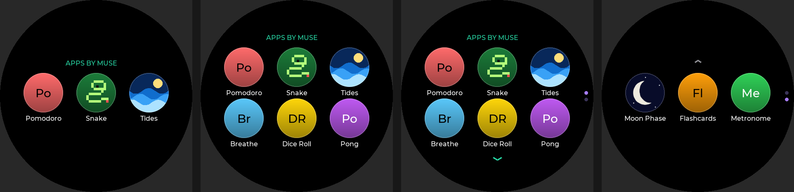

# The Lua app launcher: apps Muse writes and deploys

The **Apps** screen, one swipe left of Muse, is a launcher for apps written in
Lua. Muse writes them and installs them over its existing link to the board. The
board compiles, saves and opens each app on the spot, with **no firmware build
and no flashing**. You ask for an app in a sentence, and a minute later it's on
your desk.



## How it works

```
 you: "build me a pomodoro timer"
        |
     Muse (cloud) --- reads the API from the board:  luapp.admin {action: "api"}
        |              writes Lua, then sends:       luapp.install {id, name, color, code}
        v
     the board ------ compiles it (syntax errors go back with line numbers)
                      saves it to the luapps partition (FAT, 8 MB)
                      opens it; start-up errors go back too
                      -> "ok, running"
```

- **Runtime:** stock Lua 5.4.7 ([`firmware/lua/`](../firmware/lua/), unmodified)
  embedded in the firmware ([`luapp_vm.c`](../firmware/luapp_vm.c)). One app runs at
  a time on its own task: a 64 KB stack in PSRAM, a 384 KB Lua heap, and up to 1.5 MB
  for images and canvases. The board always keeps 512 KB free for Muse's voice.
- **Sandbox** ([`luapp_sandbox.c`](../firmware/luapp_sandbox.c)): base Lua without
  `load`, `dofile`, `require` or `collectgarbage`, plus string, table, math, utf8 and
  coroutine. There is no `io`, `os` or `debug`. Apps reach the outside world only
  through the modules below.
- **Time limits:** each callback has 250 ms (the first run of the script gets 1 s). A
  hook stops a runaway callback, and an error stops the app and shows on screen.
- **Storage:** up to 64 apps of up to 64 KB of source each, plus each app's `store`
  values and icon, in `/luapps/apps/` on the 8 MB `luapps` FAT partition
  ([`config/partitions-muse-charm.csv`](../config/partitions-muse-charm.csv)). Apps
  survive reflashing, because the partition table keeps NVS and the app slots where
  the SDK has them. Until November 2026 apps lived on a 1 MB partition: the first boot
  with the 8 MB one copies them over (`_v1copied` marks it done) and leaves the old
  one, now `luapps_v1`, as it was. The launcher keeps only the icons of the page
  showing and the next in memory (27 KB each) and loads others as pages turn.
- **Launcher:** pages of six (two rows of three 96 px round icons), one page per
  vertical swipe, with page dots. Each app draws its own icon at start-up with
  `app.icon`, saved next to the app and cached for the launcher.

## What an app can use

The full reference lives on the board: Muse reads it with `luapp.admin` and actions
`api`, `api_ui`, `api_gfx`, `api_sound` and `api_device`. The source files are
[`luapp_api.md`](../firmware/luapp_api.md),
[`luapp_api_ui.md`](../firmware/luapp_api_ui.md),
[`luapp_api_gfx.md`](../firmware/luapp_api_gfx.md),
[`luapp_api_sound.md`](../firmware/luapp_api_sound.md) and
[`luapp_api_device.md`](../firmware/luapp_api_device.md), compiled into the firmware by
[`tools/embed_text.py`](../firmware/tools/embed_text.py). After editing them, run
`embed_text.py` (the command is in its header) and rebuild.

| Module | What |
|---|---|
| `ui` | label, box, button, arc, bar, line, image, canvas, roller, slider, switch, list, scroll (up to 96 widgets); taps; `ui.every` / `ui.after` timers (16 ms or more, up to 24); background; `ui.animate` (LVGL animations: position, opacity, size, value, angle, scale); `ui.on_swipe` (up/down); `ui.on_button` (the bottom button's short press) |
| `time` | `now`, `date`, `utc`, `synced` |
| `http`, `json` | `http.get`, `http.post`, `http.request` (any method, headers, a string or JSON body up to 16 KB): bodies back up to 32 KB, one request at a time, paused during voice calls; `json.decode` / `encode` |
| `store` | per-app key/value storage that survives restarts |
| `gfx` | PNG and JPEG images (decoded with the ESP32-S3 ROM's tinfl and TJpgDec), pixel-art sprites, a canvas with drawing ops (polygons, gradients, whole tilemaps and sprite batches in one call) and touch input, zoomed canvases (2-4x, crisp), `c:partial(true)` (send the screen only what changed since the last clear), `gfx.memory()`, `gfx.stats()` / `gfx.show_stats()` (fps, ms and KB per frame, Lua and drawing time over the last second) |
| `sound` | a 4-channel synth: effects, tones, and melodies in note strings (`"C4:8 E G C5:4"`), mixed into Muse's speaker when Muse isn't talking |
| `app` | `id`, `name`, `icon(img)`, `exit()`, `keep_awake`, `brightness`, `alarm` / `on_alarm` / `cancel_alarm` / `alarms` (wake the board and open the app at a time; kept in `/luapps/_alarms`), `on_message` (for `luapp.send`) |
| `muse` | `muse.ask(text, fn)`: a typed turn to Muse, its text reply back to the app (a hook on the SDK's `@chat` console lines); `muse.status()` |
| `device`, `mic`, `motion` | battery, charging, Wi-Fi, Muse, call, volume; microphone level (the settings meter's dBFS); accelerometer and gyroscope (QMI8658 on the shared I2C bus, probed at 0x6B/0x6A) |
| `fs` | the app's own files in `/luapps/apps/<id>.fs/` (256 KB per app, 128 KB per file), removed with the app |
| `apps` | the built-in apps' data: `apps.stocks()`, `apps.wind()`, `apps.watch()` |

The screen is round: coordinates start at the centre (+x right, +y down), and
content should stay within about 200 px of it. Fonts are ASCII, plus the degree
sign and bullet.

## Muse's commands

| Command | Does |
|---|---|
| `luapp.install` | `id`, `code`, and optionally `name`, `color`, `run`. Installs or updates an app; code over 8000 characters goes in pieces (`done=false`, then `append=true`). Returns ok, or `syntax_error` / `runtime_error` with a line number, or `full`, `too_large`, `busy`. |
| `luapp.run` | Opens an installed app; returns its start-up error, if any |
| `luapp.send` | `data` (JSON text) to the running app's `app.on_message`; returns what the handler returns |
| `luapp.admin` | `action`: `api`, `api_ui`, `api_gfx`, `api_sound`, `api_device` (the reference), `screenshot` (the screen as a PNG, drawn in strips and deflated by the ROM, in 12 KB base64 pages: `offset`, `full`), `widgets` (the running app's widgets as JSON), `perf` (the last second's speed, as `gfx.stats`), `list` (apps, the running one, storage, the last unload), `logs` (the app's `print` output and later errors), `stop` (answers once it's unloaded; `force=true` reboots the board if the app won't stop in 3 s), `remove`, `source` (read code back in 3000-character pieces, for editing) |
| `app.show` | `app: "apps"` shows the launcher |

## Lifecycle

- **Opening:** tap an icon, or Muse calls `luapp.run` or installs with `run=true`.
- **Leaving:** a long-press exits back to the launcher (on a canvas with touch, hold
  still for 1.5 s). Swiping sideways changes screens: the app keeps running with its
  timers paused, and it's unloaded after 30 s off the Apps screen.
- **Updating a running app:** pieces upload while it runs, and the last piece stops
  and replaces it.
- **Unloading** frees the app's memory, graphics and timers. Its `store` is kept, and
  it starts fresh next time.
- Muse's commands are handled before the app's timers, so a busy animation can't
  starve Muse's link.

## Teaching Muse

Muse doesn't know about the launcher until you tell it. Send it
[`muse-prompts/lua-apps.md`](../muse-prompts/lua-apps.md) once, in the Muse app or
through the board:

```sh
scripts/06_ask_muse.sh --file muse-prompts/lua-apps.md
```

It covers reading the API first, choosing an id, sending large code in pieces,
handling each error reply, checking logs after you try the app, icons, and design
rules for the round screen. The device guide
([`config/device-guide.md`](../config/device-guide.md)) carries a short version, so
Muse knows the launcher exists in every conversation.

The other files in [`muse-prompts/`](../muse-prompts/) are one-off notes we sent our
Muse when the firmware grew: [`rich-apps.md`](../muse-prompts/rich-apps.md) (the
`api_ui` and `api_device` additions), [`speed.md`](../muse-prompts/speed.md) (the
16 ms timer floor and `c:partial`) and
[`partial-fix.md`](../muse-prompts/partial-fix.md) (the partial-frame fix). A Muse
that starts from today's `lua-apps.md` doesn't need them; they're kept as examples
of telling Muse about a firmware update.

## Installing the apps in this repository

Each folder in [`apps/`](../apps/) has the app's Lua source and a README with its
id, name and colour. To put one on your board, give Muse the source (paste it, or
point Muse at this repository) and ask:

> Install this Lua app on my gadget with luapp.install: id `timer`, name "Timer",
> colour 0x34C759. Send it in pieces if it's over 8000 characters.

Muse commits the apps it builds to this repository itself, with a README and a
row in the app tables, when you've sent it
[`muse-prompts/publish-apps.md`](../muse-prompts/publish-apps.md) once. It can also
read any installed app's source back with `luapp.admin` `source`.

## Screenshots and speed

- **From a Mac:** [`scripts/07_screenshots.sh`](../scripts/07_screenshots.sh) opens
  each installed app over USB, waits for it to draw (`--wait`, 8 s by default) and
  saves round PNGs in `docs/images/apps/`, plus the launcher. It uses the serial
  console's `apps COMMAND {json}` line (patch 0002) and LVGL's snapshot
  (`CONFIG_LV_USE_SNAPSHOT`, on in this project's settings).
- **For Muse:** `luapp.admin` `screenshot` returns the screen as a PNG, so Muse can
  look at what its app really draws, and `widgets` lists the running app's widgets.
- **Speed:** `luapp.admin` `perf`, `gfx.stats()` and `gfx.show_stats(true)` (an
  on-screen overlay) give frames per second, milliseconds and KB sent per frame,
  and the time in Lua and in drawing over the last second.

## Limits worth knowing

- One app at a time. Opening another unloads the first.
- `link.register` is capped at 8 KB including the SDK's own commands, so these
  commands' descriptions are short. The detail lives in `luapp.admin api`.
- Each API reply is kept to about 4 KB, which is why it's split into five actions.
- The flash app slot is about 90% full with Lua, the native apps and a custom avatar.
- Internal RAM is tight during voice calls ([memory.md](memory.md)). Lua runs from
  PSRAM, but avoid HTTP fetches in a tight loop.
