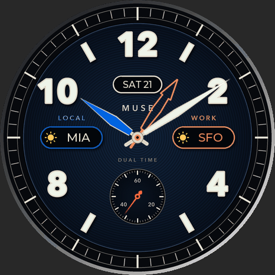
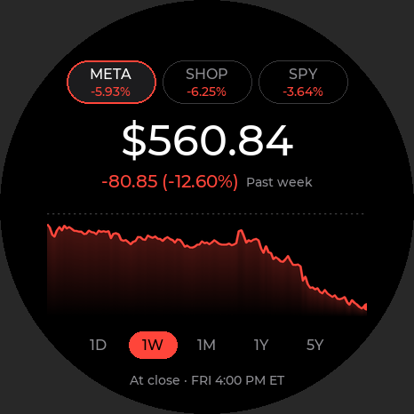
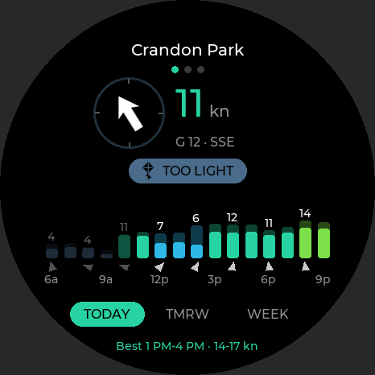

# The native apps: Watch, Stocks and Wind

Three apps written in C with LVGL and compiled into the firmware. They sit to
the right of Muse's screen:

```
Wind  |  Stocks  |  Watch  |  Muse  |  Apps  |  Settings
```

Muse drives them through commands the board registers with it (`link.register`),
and [`config/device-guide.md`](../config/device-guide.md) tells Muse what they're for.
Sources are in [`firmware/`](../firmware/). The SDK hooks that put them on screen
are in [`patches/0002`](../patches/).

They share a few rules:

- **One network task** ([`apps_net.c`](../firmware/apps_net.c)) runs every fetch, one at
  a time. It only fetches when Wi-Fi is up, the screen is awake, no voice call is
  active, and Muse's session has been steady for 3 seconds. It skips a fetch when
  internal RAM is low, so a fetch never costs Muse its voice.
- **Big buffers only when near:** the chart buffers exist only while the app is on
  screen or one swipe away, and a Lua app starting frees them at once.
- **Settings survive restarts** in NVS (namespace `museapps`).
- `app.show` with `app` = `wind`, `stocks`, `watch`, `muse` or `apps` brings any of
  them to the screen and wakes it.

## Watch



A dual-time pocket watch, two swipes right of Muse (the latest reply is between them).

- **Local** time (where you are) drives the Meta-blue hour hand, the minute hand,
  the small seconds, the date and the LOCAL window.
- **Work** time (a zone you follow) is the copper skeleton hand and the WORK window.
- The clock comes from SNTP (`pool.ntp.org`). Until that syncs, it uses the `Date`
  header of Muse's own replies, so the time is right even on networks that block NTP.
- The dial is pre-rendered by [`tools/render_watch.py`](../firmware/tools/render_watch.py)
  into a 256-colour image that LVGL draws straight from flash.
- Time zones: 85 built-in names (cities, airport-style codes such as MIA, and ET/PT)
  with their IANA zones and DST rules
  ([`muse_zones.c`](../firmware/muse_zones.c), generated from the Mac's zoneinfo by
  [`tools/gen_zones.py`](../firmware/tools/gen_zones.py)), or any place Muse gives
  as a POSIX TZ rule.

| Command | Parameters | Does |
|---|---|---|
| `watch.set_zone` | `slot` (`local` or `work`); `zone` (city code, city or IANA name: `TLV`, `Tel Aviv`, `Asia/Jerusalem`), or `tz` (POSIX rule) with `label` (up to 4 letters) | Sets a zone; returns both zones' times |
| `watch.swap` | | Swaps local and work |
| `watch.get` | | Both zones, their times, and whether the clock is synced |

Muse can keep local time in step when it learns you've travelled: you tell it, or it
sees a flight in your calendar.

## Stocks



META, SHOP and SPY, three swipes right of Muse: price, change, and a chart over 1D,
1W, 1M, 1Y or 5Y. Tap the pills to switch symbol and range.

- Data comes from Yahoo Finance's v8 chart API (no key), fetched by the board and
  parsed without a JSON tree.
- It fetches only while the tile is up, plus one fill of the pills after boot, and
  never during a voice call.
- The chart is an 8-bit coverage map tinted with the trend colour (green or red),
  45 KB instead of 180 KB.

| Command | Parameters | Does |
|---|---|---|
| `stocks.show` | `symbol` (META, SHOP, SPY), `range` (1D, 1W, 1M, 1Y, 5Y) | Shows the tracker on that symbol and range |
| `stocks.get` | | Latest quotes for all three |

## Wind



A kite forecast in knots, four swipes right of Muse.

- **Spots:** Crandon Park and Stiltsville (Key Biscayne, Miami), plus one spot Muse
  sets for anywhere else you ask about.
- **Views:** now (speed, gusts, direction and a rating from *light* to *nuking*),
  today and tomorrow hour by hour, and the week day by day, with the best session
  window marked.
- Data comes from [Open-Meteo](https://open-meteo.com/) (no key), using the sea grid
  cell (`cell_selection=sea`) so coastal spots get the wind over the water.

| Command | Parameters | Does |
|---|---|---|
| `wind.set_spot` | `name` (up to 15 characters), `lat`, `lon` | Sets the third spot and shows it (kept across restarts) |
| `wind.show` | `spot` (Crandon, Stiltsville or the set spot's name), `view` (today, tomorrow, week) | Shows that spot and view |
| `wind.get` | | Each spot's wind now and its best session windows |

## Customising

The defaults are ours. To change them, edit the code, rebuild and reflash:

| What | Where |
|---|---|
| Watch zones at first boot (MIA local, SFO work) | `watch_core.c`, `watch_cfg_default`: `muse_zone_find("MIA")` and `("SFO")`. Muse can also change them any time with `watch.set_zone`. |
| Stock symbols | `stocks_data.c`, `stocks_symbols[]` (three symbols; update the command text in `muse_apps.c` and the device guide too) |
| Kite spots | `wind_ui.c`, `s_spots[]` (name, latitude, longitude). The third spot is Muse's to set. |
| What Muse knows about you and the apps | [`config/device-guide.md`](../config/device-guide.md), up to 4096 bytes |
| The tile order | `MUSE_APPS_LEFT` in `muse_apps_ui.h` and `SETTINGS_COL` in the SDK's `muse_ui.c` (patch 0002) |

Keep command descriptions short: `link.register` is capped at 8 KB including the
SDK's own commands, and the apps already use most of it.

## Tests and previews

```sh
firmware/tests/fetch_fixtures.sh    # real Yahoo and Open-Meteo responses for the parser tests (not committed)
firmware/tests/run_host_tests.sh    # zones vs zoneinfo, watch logic and dial decoder, stock and wind parsers,
                                    # the Lua sandbox and JSON module, the PNG decoder and the synth (ASan/UBSan)
```

The host tests build cJSON from ESP-IDF's component cache, so build the firmware
once first.

Renderers that write the PNGs in [`firmware/preview/`](../firmware/preview/) and the
generated sources:

```sh
PY=toolchain/tools-venv/bin/python
$PY -I firmware/tools/render_watch.py firmware firmware/preview     # dial -> watch_assets.c + previews
$PY -I firmware/tools/render_wind.py firmware firmware/preview firmware/tests/fixtures   # wind icons -> wind_assets.c + previews
$PY -I firmware/tools/preview_stocks.py firmware/tests/fixtures firmware/preview         # stocks previews
$PY -I firmware/tools/preview_launcher.py firmware/preview                             # launcher layouts
$PY -I firmware/tools/gen_zones.py firmware/muse_zones.c            # time zones
```
